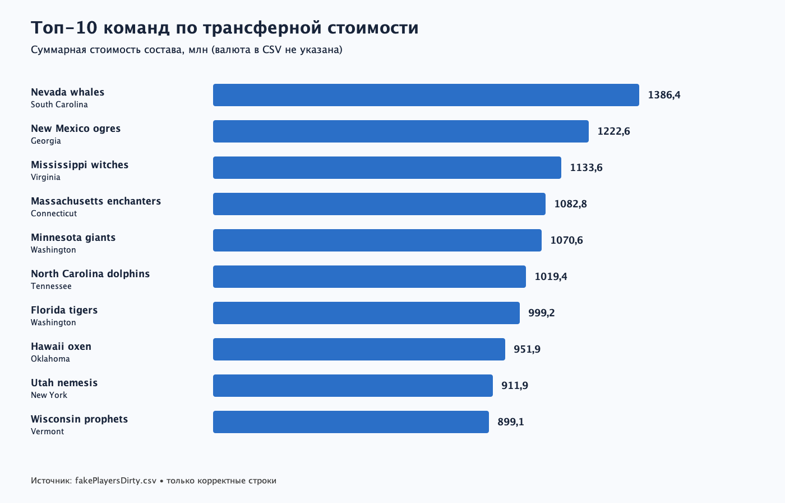
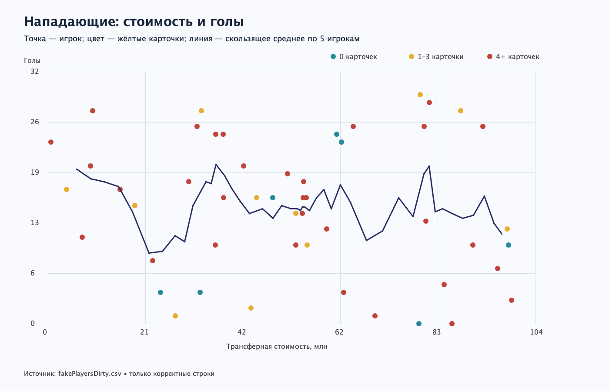

# Кормилец

Выполнены задания 1–5 практикума Kotlin, визуализация — вариант 2 «Цена и результативность».

- Модели Player, Team, Position и устойчивый CSV-парсер с подсчётом пропущенных строк.
- Все восемь запросов IResolver.
- Дополнительные задания: агрегаты команд с by lazy, потоковый поиск, sealed-фильтры и DSL отчёта.
- Топ-10 команд по стоимости и диаграмма стоимости/голов нападающих со скользящим средним и цветом жёлтых карточек.
- 24 теста kotlin.test: маппинг, запросы, дополнительные возможности.

Локальная проверка прошла на JDK 21 с временным init-скриптом; основная конфигурация проекта сохраняет JDK 17.
Грязный CSV: 220 игроков, 30 пропущенных строк.

## Результаты

Текст консольного вывода: [console-output.txt](console-output.txt).

